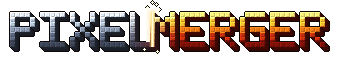

<div align="center">

# 🕹️ Pixel Merger

**A pixel-art merge and auto-battle game. Buy units, merge them into stronger ones, and watch your army fight.**

[](https://github.com/aikitori/pixel-merger/actions/workflows/android.yml)
[](https://github.com/aikitori/pixel-merger/releases)

[](LICENSE)

[**Play in the browser**](https://aikitori.github.io/pixel-merger/) · [**Download APK**](https://github.com/aikitori/pixel-merger/releases)



</div>

Inspired by the Warcraft III custom map "Binders". Alpha: expect rough edges and balance changes.

## How to play

Every round has two phases:

1. **Build:** spend gold on units and place them on the battlefield. Drag one unit onto another to merge them.
   A recipe takes exactly two ingredients (order does not matter) and results can be merged again, so
   combinations go several tiers deep.
2. **Battle:** the fight runs automatically within a fixed time window while monsters keep spawning. Survive until
   the timer ends to clear the round. Every kill earns gold for the next build phase.

During battle you can give orders: hold position, guard another unit, attack a target, walk somewhere, or use
abilities.

## Features

**Units and merging**

- **23 unit lines, 100 combinations:** each has its own behavior, attack form, body type, ability and signature
  trait. Five tiers per line, plus legendary results.
- **Recipe book:** shows every combination with ingredients, cost, unlock round and stats. Locked recipes are
  greyed out, and some recipes are secret until you find them.
- **Merge all:** one button merges every matching pair, lowest tier first. Higher tiers can be bought directly
  from round 8, and surplus units can be sent back for a partial refund.
- **Village:** each house sells its own category of units and can be upgraded for permanent bonuses during the
  run. Upgraded houses unlock extra unit lines.

**Battle**

- **Orders:** hold, guard another unit, attack a target, walk somewhere, or trigger abilities by hand. A toggle
  switches automatic abilities off if you want full control.
- **Abilities:** more than 20 active and passive abilities, from arrow rain and chain lightning to resurrection,
  petrification and earthquakes.
- **Battle speed:** 1x, 2x or 3x, pause at any time (the game also pauses by itself when the app goes to the
  background).

**Enemies and variety**

- **17 enemy types and 4 bosses:** with their own abilities, scaling with every round. Elites show up from round 8.
- **Round modifiers:** most normal rounds roll a special rule such as fog, blood moon, snow or golden rain.
- **Boss rounds and bonus rounds:** every fifth round is special. Bosses fight in their own arenas and drop a
  reward, bonus rounds pay triple gold.
- **Events:** merchants, smiths, recruits, gambles and more offer three cards between rounds.
- **Terrain:** the field starts full of obstacles that disappear boss by boss, and the wall style changes with it.

**Progress and platform**

- **Saved runs:** the current run is saved and can be continued from the menu, including open events.
- **Records and achievements:** secret recipes, achievements and a high score persist between runs.
- **Strategy-game controls:** mouse (select, box select, right-click orders, control groups), keyboard shortcuts
  and touch (tap, long press), with a short tutorial on the first run.
- **Animated units:** idle, walk, attack and death animations for every figure.
- **Sound:** CC0 and synthesized effects and music, switchable between all on, effects only and off.
- **Languages:** German and English (follows the device).
- **Plays anywhere:** Android and any modern browser, no installation needed.

Rules and design notes: [docs/GAME_DESIGN.md](docs/GAME_DESIGN.md) (German).

## Controls

| Action | Mouse and keyboard | Touch |
|---|---|---|
| Select | Left click, drag a box, Shift/Ctrl/double click for more | Tap |
| Command (walk, attack, guard) | Right click | Tap the field or an enemy, long press to guard |
| Merge | Drag a unit onto a matching one, `V` merges everything | Drag |
| Hold / free / guard | `H` / `S` / `G` | "Command" button |
| Ability | `Q` | Ability button |
| Control groups | `Ctrl+1-9` save, `1-9` select, `Ctrl+A` all | - |
| Start battle, village, recipes | `Enter`, `D`, `R` | Buttons |
| Pause, battle speed | `Space`, `+` / `-` | Buttons |
| Menu | `Esc` | Back key |

The in-game menu lists all of them.

## Install

- **Browser:** https://aikitori.github.io/pixel-merger/ (always the current state of `main`)
- **Android:** download the debug APK from the [releases](https://github.com/aikitori/pixel-merger/releases)
  (tags `alpha-X.Y.Z`) and install it. Updates work as long as the debug key stays the same.

## Development

Requires [Godot 4.7](https://godotengine.org/download) (standard build, no .NET).

```bash
git clone https://github.com/aikitori/pixel-merger.git
cd pixel-merger
godot --path . --import   # first run only
godot --path .            # or open project.godot and press F5
```

Android build (see [docs/ANDROID.md](docs/ANDROID.md) for SDK and signing):

```bash
tools/build_android.sh debug   # build/pixel-merger-debug.apk
```

Tests (headless, each should end with `... OK` and no `FAIL` or `ERROR` lines):

```bash
godot --headless res://scenes/dev/smoke.tscn
godot --headless res://scenes/dev/input_test.tscn
godot --headless res://scenes/dev/anim_test.tscn     # 2-3 minutes
godot --headless res://scenes/dev/units_test.tscn
godot --headless res://scenes/dev/events_test.tscn
godot --headless res://scenes/dev/fuzz_test.tscn
```

### Continuous integration

Every push to `main` runs all six tests and builds a debug APK (`.github/workflows/android.yml`) and deploys the
web version to GitHub Pages (`pages.yml`). Alpha releases are tagged `alpha-X.Y.Z` and published as prereleases
with the debug APK. Tags starting with `v` run the signed release job and need repository secrets, see
[docs/ANDROID.md](docs/ANDROID.md).

### Generated content

Units, sprites, sounds and names are generated by Python scripts (standard library only). Do not edit the
generated files by hand; change the source and regenerate:

| Source | Generates |
|---|---|
| `tools/content.py` | unit lines, combinations, abilities, traits |
| `tools/generate_data.py` | `data/*.tres`, English names |
| `tools/generate_sprites.py` | sprites, animation strips, arenas, village, UI images |
| `tools/generate_audio.py` | sound effects and music |

```bash
python3 tools/generate_data.py
python3 tools/generate_sprites.py
godot --headless --path . --import
```

Some art (arena textures, boss arenas, village, bosses, figures) was made with Stable Diffusion and imported once
with `tools/import_sd.py` (needs ComfyUI, not exactly reproducible).

### Project layout

```
assets/     sprites, audio, fonts (generated)
data/       units, recipes and enemies as .tres (generated)
docs/       game design, Android build
scenes/     scenes, dev/ holds the tests
scripts/    GDScript
shaders/    post-processing
tools/      Python generators
```

### Contributing

Issues and pull requests are welcome. Code comments and in-game text are German; every new German string needs an
English entry in `scripts/i18n/ui_en.gd`. The web build has no system font, so use only Latin-1 characters (no
emoji or symbols). Tests must not depend on randomness. More notes in [CLAUDE.md](CLAUDE.md).

## License

Code, music and self-made sounds: [GPL-3.0-or-later](LICENSE), Copyright (C) 2026 aikitori
(versions up to alpha 0.1.8 were MIT).

Third-party assets:

- Graphics build on the [Dungeon Crawl Stone Soup tiles](https://opengameart.org/content/dungeon-crawl-32x32-tiles-supplemental)
  (CC0, see `tools/dcss/README.txt`). Arena textures, boss arenas, village, bosses and the other figures were drawn
  with Stable Diffusion, using the Crawl tiles as templates.
- Most sound effects are from [Kenney](https://kenney.nl) and the
  [512 Sound Effects (8-bit style)](https://opengameart.org/content/512-sound-effects-8-bit-style) pack by
  Juhani Junkala (CC0, see `tools/sfx_cc0/README.txt`).
